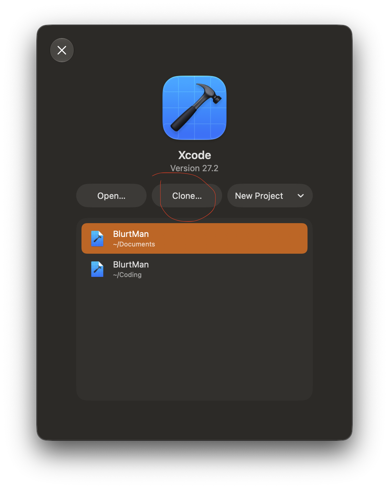
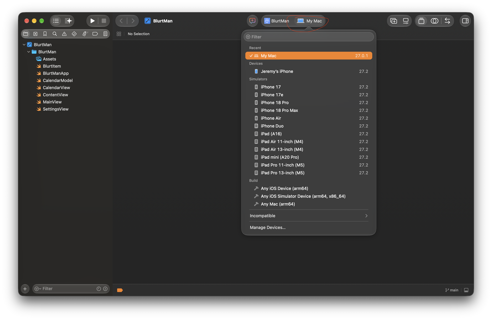
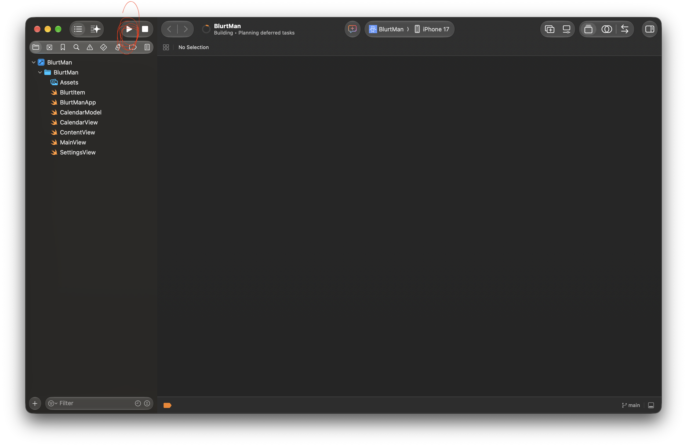

**(NOTE: The iOS version probably looks a bit nicer than the mac version/is more stable since I mainly focused on the iOS version)**

# BlurtMan

BlurtMan is an iOS/macOS app I created for Hack Club Terra week 3. It's pretty barebones right now, and I'll probably expand it in the future.

## How to run
Running the app on mac is simple - download the zip, extract it, and if it says something along the lines of "untrusted app", then go into System Settings -> Privacy & Security -> Scroll to the bottom and click "Open Anyway".

To test the app's iOS version, it can be simulated on XCode. Here are the steps:

### 1. Open XCode + Clone

If you don't already have XCode, download it from the App Store.

Once you have opened XCode, click "Clone".

Then paste in the URL of this repository: https://github.com/JeremyLikesCats/BlurtMan.git

### 2. Open the project and run
The project should automatically open. Once you're in the page, select the destination and set it to be an iPhone 17.

### 3. Run the project!
Then just click the run button on the top left to run the app on the simulated iPhone 17!

## What is blurting?

Blurting is a very effective way of spaced reptition that essentially brute forces your memory. In every blurt session, you would take out a piece of paper and write down everything you know about a certain subject. At the end, you would see what you missed and have a clear idea of gaps in your knowledge, allowing you to target these gaps and increase your knowledge in the most effective way. 

## What is this app for?

If you're like me and you're studying many subjects at once, it's difficult to keep track of when to revise what at the most effective times. This app aims to solve this issue by creating a clear yet customizable structure for your blurting sessions.

### Features

- Blurt schedule making
- Customizable blurt schedule
- Apple calendar integration (customize event alert times/when events should take place)
- Colors for each subject

## Showcase

### App Icon

### Home Screen

### Settings

### Schedule

### Calendar Integration

