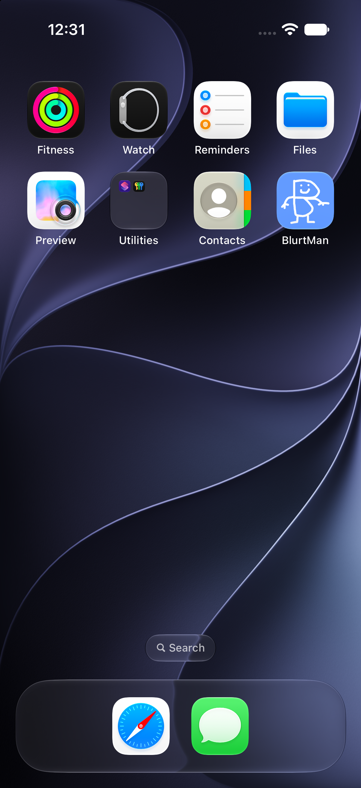
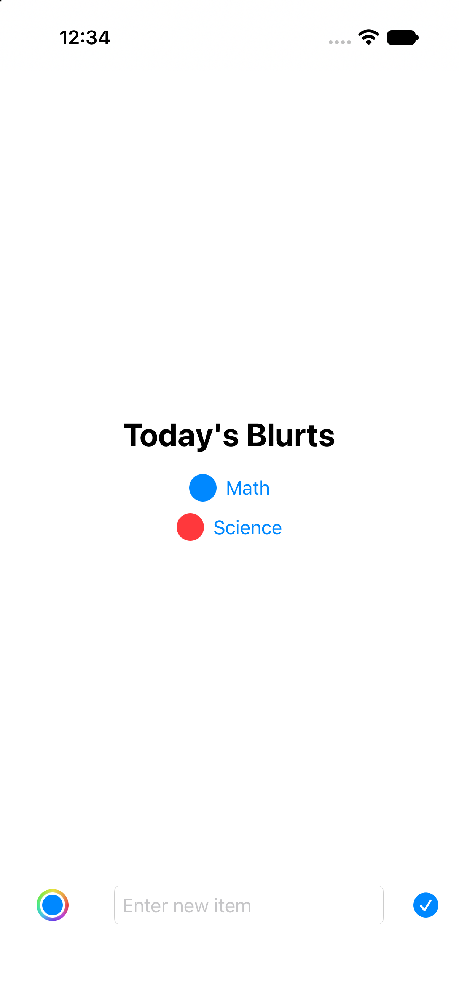
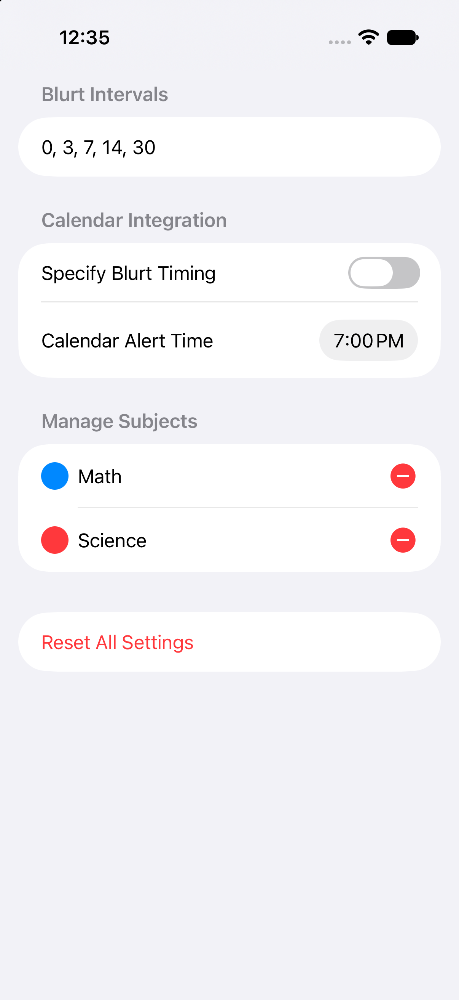
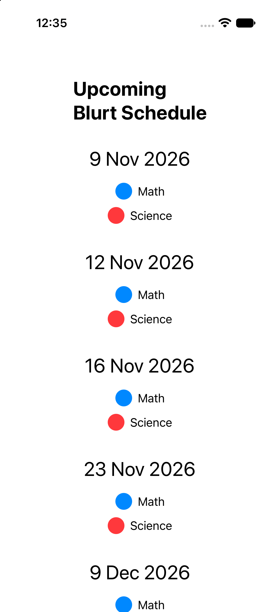
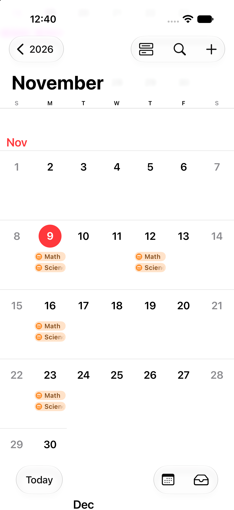

# BlurtMan

BlurtMan is an iOS/macOS app I created for Hack Club Terra week 3. It's pretty barebones right now, and I'll probably expand it in the future.

## What is blurting?

Blurting is a very effective way of spaced reptition that essentially brute forces your memory. In every blurt session, you would take out a piece of paper and write down everything you know about a certain subject. At the end, you would see what you missed and have a clear idea of gaps in your knowledge, allowing you to target these gaps and increase your knowledge in the most effective way. 

## What is this app for?

If you're like me and you're studying many subjects at once, it's difficult to keep track of when to revise what at the most effective times. This app aims to solve this issue by creating a clear yet customizable structure for your blurting sessions.

### Features

- Blurt schedule making
- Customizable blurt schedule
- Apple calendar integration (customize event alert times/when events should take place)
- Colors for each subject

## Showcase

### App Icon

### Home Screen

### Settings

### Schedule

### Calendar Integration

